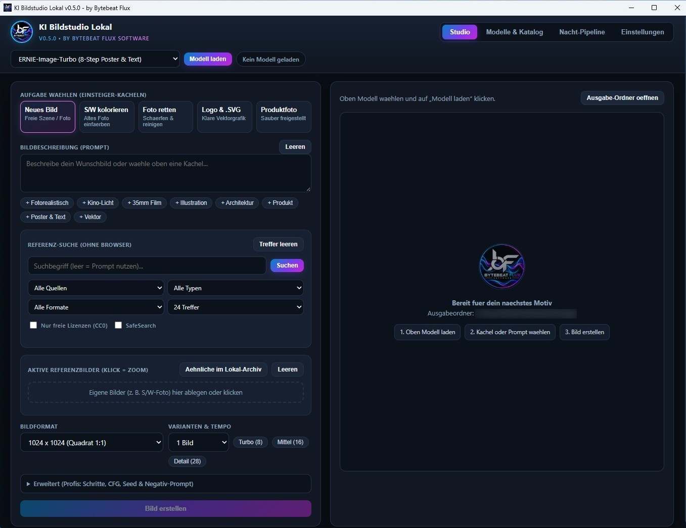
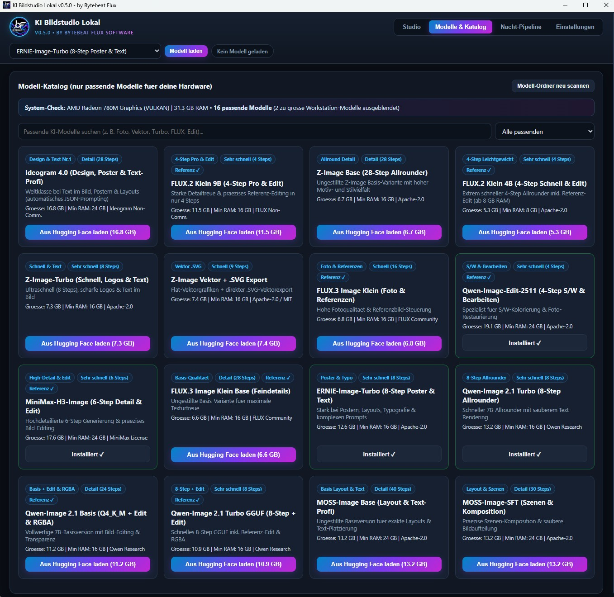

# KI Bildstudio Lokal (v0.5.0)

**Kostenloser, nativer Windows KI-Bildgenerator von Bytebeat Flux** – läuft komplett lokal & offline auf deiner Grafikkarte (**Vulkan**, **CUDA** oder **CPU**), entwickelt mit **Rust + Tauri v2**, ganz ohne Cloud-Zwang, ohne Python-Installation und ohne Hintergrund-Browser.

---

## Direkt-Download für Windows (v0.5.0)

> **Empfehlung für Windows 10 / 11 (64-Bit):** Einfach den Installer laden, ausführen – fertig!
>
> * **[Windows-Installer herunterladen (KI Bildstudio Lokal_0.5.0_x64-setup.exe)](https://github.com/BytebeatFlux/KI-Bildstudio-Lokal/releases/latest/download/KI.Bildstudio.Lokal_0.5.0_x64-setup.exe)** *(ca. 6,4 MB)*
> * **[Portable Version herunterladen (KI Bildstudio Lokal.exe)](https://github.com/BytebeatFlux/KI-Bildstudio-Lokal/releases/latest/download/KI.Bildstudio.Lokal.exe)** *(ohne Installation direkt startbar)*
> * **[Alle Release-Dateien & MSI-Paket anzeigen](https://github.com/BytebeatFlux/KI-Bildstudio-Lokal/releases/latest)**
>
> *Hinweis zu Windows SmartScreen:* Da es sich um ein freies Open-Source-Projekt ohne kostenpflichtiges Code-Signing-Zertifikat handelt, erscheint beim ersten Start ggf. die Meldung „Der Computer wurde durch Windows geschützt“. Klicke dort einfach auf **Weitere Informationen → Trotzdem ausführen**.

SHA256-Prüfsummen (v0.5.0)

* `KI Bildstudio Lokal_0.5.0_x64-setup.exe`: `06709E1621A9A6F81CD7EF645685E9264633D76FB7945F35733C1B3D8D8DB4A5`
* `KI Bildstudio Lokal.exe`: `B46649D02131EAE9808202348D28B7A6BE3FD62BAAA779BE238CAE0DCCA88C73`
* `KI Bildstudio Lokal_0.5.0_x64_en-US.msi`: `3BF56EC9C210F822059503FFF9E88042CCD238F63181FF0E96196DCA25928588`

---

### Studio-Ansicht (Prompt, Referenz-Suche & 1-Klick Export)

### Hardware-gefilterter Modell-Katalog

---

## Highlights & Funktionen

* **Rein natives Desktop-Fenster:** Schlanke Windows-App (~7 MB) ohne Python, Node.js oder Browser-Ballast.
* **Vulkan-Turbo ab Werk:** Optimiert für AMD Radeon (z. B. 780M), Intel Arc & NVIDIA (--auto-fit on, --vae-tiling, --flash-attn auto).
* **Einsteiger-Kacheln & Profi-Modus:** Schnellstart für *Neues Bild*, *S/W kolorieren*, *Foto retten*, *Logo & .SVG* sowie *Produktfoto* – Steps, CFG, Seed & Negativ-Prompt bleiben sauber eingeklappt.
* **Intelligenter Modell-Katalog:** Zeigt passende Modelle für deinen Arbeitsspeicher und spart Platz durch **NTFS-Hardlinks** für gemeinsame Text-Encoder & VAEs (*FLUX.2 / FLUX.3 Klein, Qwen-Image 2.1, Z-Image, ERNIE-Image, MOSS-Image, MiniMax-H3, Ideogram 4.0*).
* **Integrierte Referenz-Suche:** Durchsucht *Wikimedia Commons*, *Openverse*, Websuche, optional *Pexels* / *Brave API* und ein lokales **dHash-Fotoarchiv** – mit Filtern für Bildtyp, Format, SafeSearch & CC0.
* **1-Klick Export & Nacht-Pipeline:** Direkter .JPG- und .SVG-Vektor-Export (tracer), Varianten-Serien (1 / 2 / 4) und fortsetzbare Über-Nacht-Batch-Pipeline.

---

## Systemvoraussetzungen & Selbst bauen

* **Betriebssystem:** Windows 10 / 11 (64-Bit)
* **Hardware:** Vulkan-fähige GPU (AMD Radeon, Intel Arc, NVIDIA) oder CUDA; ab 8 GB RAM (16–32 GB empfohlen)
* **Selbst kompilieren (Rust + 	auri-cli):** cargo tauri dev bzw. Build-Release.cmd

---

## Lizenzen & Rechtliche Hinweise

* **Quellcode:** **Apache License 2.0** (LICENSE & NOTICE). Urheber: **Bytebeat Flux**. Name und Logo (*Bytebeat Flux*) bleiben marken- und namensrechtlich vorbehalten (Apache-2.0 Abschnitt 6).
* **KI-Engine:** Lädt zur Laufzeit leejet/stable-diffusion.cpp (MIT-Lizenz).
* **KI-Modelle:** Keine Modellgewichte enthalten. Modelle werden direkt von Hugging Face geladen; Nutzer sind für die jeweilige Modell-Lizenz (Apache-2.0 vs. Non-Commercial) selbst verantwortlich. Unabhängiges Community-Projekt.
* **Bildersuche:** Web-Treffer können urheberrechtlich geschützt sein; bitte auf freie Lizenzen (z. B. CC0-Filter) achten.